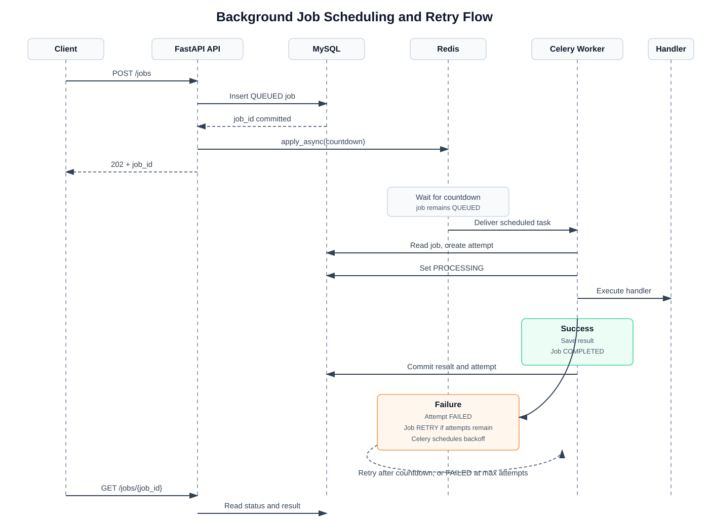

# Background Job Processing System

A small FastAPI and Celery application for submitting, scheduling, processing, retrying, and tracking background jobs.

## What is implemented

- FastAPI endpoints for creating jobs and reading their status.
- Redis as the Celery message broker.
- MySQL in Docker for application data.
- Synchronous Celery prefork workers using SQLAlchemy and PyMySQL.
- Job lifecycle tracking: `QUEUED`, `PROCESSING`, `COMPLETED`, `RETRY`, and `FAILED`.
- Per-attempt history in the `job_attempts` table.
- Delayed one-time execution with `delay_seconds` and Celery `countdown`.
- Retry scheduling with exponential backoff when attempts remain.
- Result and failure details stored in MySQL.

## Request flow



1. The API creates a job with `QUEUED` status.
2. The API publishes `jobs.process_job` to Redis and returns the job ID.
3. A Celery worker reads the job from MySQL and marks it `PROCESSING`.
4. The worker runs the registered handler.
5. Successful work stores the result and marks the job `COMPLETED`.
6. Failed work records an attempt and either schedules a retry or marks the job `FAILED`.
7. Clients read the current state with `GET /jobs/{job_id}`.

## Quick start

See [SETUP.md](SETUP.md) for the complete local setup and test procedure.

## Main endpoints

### Create a job

```http
POST /jobs
Content-Type: application/json
```

```json
{
  "a": 5,
  "b": 7,
  "delay_seconds": 10
}
```

The API returns `202 Accepted` with a `job_id`. The task is processed asynchronously.

### Read a job

```http
GET /jobs/{job_id}
```

The response contains the current status, payload, result, and maximum attempt count.

## Project structure

```text
apis/                 FastAPI routes
database/             Async API and sync worker database configuration
models/               SQLAlchemy models
services/             Job orchestration and task handlers
workers/              Celery application and task definitions
migrations/           Alembic migrations
docker-compose.yml    MySQL, Redis, and Celery worker services
```
